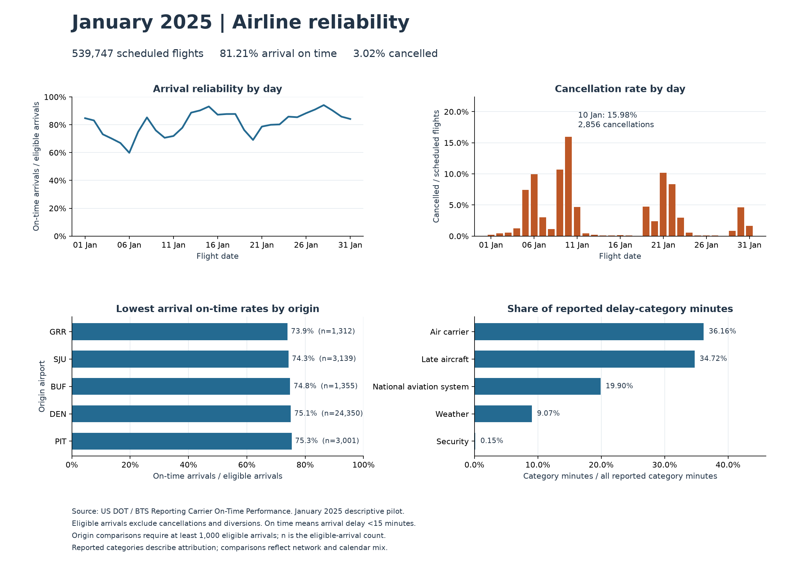

# Airline Operations Analytics & Delay Prediction

A portfolio project for data analyst, business intelligence, and data scientist applications.

**Business question:** Where are flight disruptions concentrated, and which scheduled flights have a higher risk of arriving late?

**Status:** January 2025 acquisition, preparation, and the first business-analysis SQL are complete. All 539,747 records are retained. One source measurement anomaly is explicitly flagged. The Tableau workbook and full-year analysis/modelling remain in progress.

## Intended audience and decisions

An airline operations manager needs to monitor service reliability, identify routes and departure windows that warrant investigation, and prioritise disruption planning. The final work will connect each finding to a practical recommendation and state what the data cannot establish.

## Technology choices

| Tool | Purpose |
| --- | --- |
| Python and pandas | Inspect and clean data; build repeatable preparation scripts |
| SQL with DuckDB | Store analytical tables locally and demonstrate joins, CTEs, aggregations, and window functions |
| Jupyter and Matplotlib | Explore distributions, check assumptions, and explain findings |
| Tableau Public | Build and share interactive portfolio dashboards |
| scikit-learn | Build and evaluate arrival-delay classifiers after the analytics foundation is complete |
| Git and GitHub | Track changes and present reproducible work |

DuckDB runs within Python and supports a local database file, avoiding a separate database server. Tableau will consume CSV exports produced by SQL; a direct database connector is not required.

References: [DuckDB Python documentation](https://duckdb.org/docs/stable/clients/python/overview), [Tableau Public](https://public.tableau.com/app).

## Data and initial scope

Use the US Bureau of Transportation Statistics **Reporting Carrier On-Time Performance** dataset. Its flight-level records support comparisons by airline, airport, route, calendar period, and scheduled departure time, as well as analysis of recorded delay categories.

- Start with January 2025 to establish ingestion, validation, and metric calculations.
- Expand to January–December 2025 for the final analysis and chronological model evaluation.
- Analyse reported US domestic flights; do not describe the coverage as all global or all US flights.
- Record the download date, source URL, selected fields, row counts, and file checksums when acquiring data.
- Keep raw data unchanged and outside Git. Commit scripts, SQL, metadata, and appropriately sized presentation outputs.
- Obtain carrier and airport lookup tables and document their join keys.

Sources: [official download page](https://www.transtats.bts.gov/DL_SelectFields.aspx?QO_fu146_anzr=%5D&gnoyr_VQ=FGJ), [field definitions](https://www.transtats.bts.gov/Fields.asp?QO_fu146_anzr=b0-gvzr&gnoyr_VQ=FGJ), [BTS reporting guidance](https://www.bts.gov/topics/airlines-and-airports/number-31-technical-directive-time-reporting-effective-jan-1-2019).

An Australian alternative is [BITRE domestic on-time performance](https://www.bitre.gov.au/statistics/aviation/otphome). Its published monthly aggregates suit airline and route trend analysis; they would require a different scope from the proposed flight-level prediction task.

## Questions the analysis will answer

1. How do arrival reliability and cancellation rates change across months?
2. Which airlines, origin airports, and directional routes have high disruption rates and substantial flight volumes?
3. How does performance vary by scheduled departure hour and day of week?
4. Which recorded delay categories account for the most reported delay minutes?
5. How do airline comparisons change when comparing common routes and similar departure windows?
6. Can schedule information identify flights at higher risk of an arrival delay of at least 15 minutes?

## Metric contract

These are project definitions to implement and validate against the downloaded schema. Always display denominators and missing-data counts.

| Metric | Project definition |
| --- | --- |
| Scheduled flights | Count of valid flight records in the selected reporting scope |
| Eligible arrivals | Non-cancelled, non-diverted flights with a valid arrival-delay observation |
| Arrival on-time rate | Eligible arrivals with arrival delay below 15 minutes / eligible arrivals |
| Arrival delay rate | Eligible arrivals with arrival delay of at least 15 minutes / eligible arrivals |
| Cancellation rate | Cancelled flights / scheduled flights |
| Diversion rate | Diverted flights / scheduled flights |
| Average positive arrival delay | Mean of arrival delay clipped at zero, over eligible arrivals |
| Delay severity | Median and 90th percentile arrival delay among eligible flights delayed at least 15 minutes |
| Delay category share | Sum of a reported category's minutes / sum of all reported category minutes in the eligible cause-reporting subset |

Preserve signed delays in the underlying data. Do not replace missing delays on cancelled flights with zero. Compute rates from summed counts rather than averaging subgroup percentages. Validate cancellation and diversion flags and their overlap before defining any combined disruption measure. Apply a documented minimum flight count to ranked comparisons and show their volumes.

Recorded delay categories describe reported attribution; comparisons do not establish causal effects. Do not infer passenger impact, revenue loss, or savings without supporting data and explicit assumptions.

## Tableau deliverable

Build one workbook with three analytical views:

1. **Operations overview:** flight volume, arrival on-time rate, cancellation rate, diversion rate, and monthly trends.
2. **Disruption hotspots:** airline, airport, and route comparisons; departure-hour and day-of-week heatmap; rates alongside volumes.
3. **Delay diagnostics:** reported delay-category minutes, severity distribution, and comparisons within common routes.

Include date, airline, origin, and destination filters; clear metric definitions; accessible colours; useful tooltips; and source/coverage notes. Keep aggregate exports small enough to explore comfortably. Prediction results can become a separate extension after evaluation.

## Data science extension

- **Target:** arrival delay of at least 15 minutes, conditional on a flight completing without diversion and having an observed arrival delay. This does not predict cancellation or overall disruption risk.
- **Prediction point:** before scheduled departure, using schedule information available at that point.
- **Initial features:** reporting airline, origin, destination, scheduled departure window, scheduled elapsed time, distance, month, and day of week.
- **Excluded features:** actual departure/arrival times, departure delay, taxi times, realised weather, cancellation/diversion outcomes, and reported delay causes. These are unavailable at the prediction point or reveal outcomes.
- **Baselines and candidates:** constant-probability baseline, logistic regression, then a tree-based candidate if justified by initial results and runtime.
- **Evaluation:** train on January–August, tune on September–October, and hold November–December aside for a final evaluation. Split by flight date; fit preprocessing on training data only. Historical features, if added, must use information available before each prediction.
- **Measures:** average precision, ROC-AUC, precision and recall at a validation-selected threshold, and probability calibration. Report class prevalence and performance by airline, airport, and month.
- **Interpretation:** explain error tradeoffs, seasonal limits, and selection bias from excluding cancellations/diversions. Feature importance is not a causal explanation.

## Build milestones

- [x] Define the business question, technology choices, and deliverables.
- [x] Acquire one month of source data and document its schema and provenance.
- [x] Validate types, missingness, flight identifiers, duplicates, observed-source dimension joins, and status flags.
- [x] Build repeatable cleaning scripts and a local analytical database.
- [x] Implement SQL metrics and verify January aggregate counts and rates.
- [ ] Expand to the complete 2025 analysis period.
- [x] Explore the January pilot and produce evidence-backed findings.
- [ ] Export Tableau tables, build the workbook, and reconcile dashboard totals with SQL.
- [ ] Train and evaluate the prediction extension.
- [ ] Prepare screenshots, a concise business case study, limitations, and reproduction instructions.

The first complete portfolio release is the analytics pipeline, SQL, Tableau dashboard, and case study. The prediction extension follows that release.

## Repository layout

```text
data/raw/          Original downloads; ignored by Git
data/processed/    Cleaned tables and local database; ignored by Git
data/metadata/     Source manifest, checksums, column profiles, and field definitions
notebooks/         Exploration and model experiments
src/               Repeatable data preparation and modelling code
sql/               Table definitions, quality checks, and analytical queries
tableau/           Tableau workbook and dashboard assets
reports/           Findings, figures, and final case study
```

## Acquired data: January 2025

Downloaded directly from the [official BTS archive](https://transtats.bts.gov/PREZIP/On_Time_Reporting_Carrier_On_Time_Performance_1987_present_2025_1.zip). The ZIP is 27,108,664 bytes and contains a 243,177,378-byte CSV plus the publisher's `readme.html`. Both the archive and extracted contents remain unchanged under `data/raw/`.

| Observed inventory | Value |
| --- | --- |
| Flight records | 539,747 |
| Date coverage | 1–31 January 2025; all 31 dates present |
| Named fields | 109 |
| Reporting airlines | 14 |
| Airports across origin and destination | 329 |
| Directional origin–destination routes | 5,649 |
| Cancelled records | 16,312 |
| Diverted records | 1,166 |
| Non-cancelled, non-diverted records with observed arrival delay | 522,269 |

The source has 110 physical columns: 109 named fields and one extra unnamed column from a trailing delimiter. That extra column is blank in every record. Preserve it in raw data and remove it explicitly during preparation.

**Checks completed:** ZIP CRC verification, SHA-256 checksums, all CSV record widths, requested-month coverage, status-flag values, cancellation/diversion overlap, and consistency of `ArrDel15` with the 15-minute threshold for eligible arrivals. No out-of-period records, invalid status flags, overlapping cancellation/diversion flags, or target-indicator mismatches were found. All 17,478 missing arrival delays belong to cancelled or diverted records; no eligible arrival is missing its delay.

These are acquisition inventory counts. The subsequent preparation step confirms that there are no duplicate records and retains the same row count. External airline-name/airport-name enrichment remains optional future work; the current dimensions use mappings observed in the flight records.

Metadata suitable for Git:

- [Source manifest](data/metadata/bts_2025_01_manifest.json): source URL, acquisition timestamp, archive/member sizes, checksums, and selection scope.
- [Column and file profile](data/metadata/bts_2025_01_profile.json): blank counts and example text values for every physical column, daily coverage, and basic checks.
- [Data dictionary](data/metadata/bts_2025_01_dictionary.json): the publisher's descriptions for all 109 named fields, extracted from the bundled README.

### Reproduce acquisition

From the repository root, with Python 3.9+ and `curl` available:

```bash
python3 src/acquire_bts.py --year 2025 --month 1
```

This step uses only the Python standard library and `curl`; no Python packages need installing yet. It downloads the monthly archive if absent, verifies and extracts it, scans every CSV record, and writes metadata. A cached archive must match its recorded checksum. Re-running January 2025 from the cache reproduces identical metadata. Other months use separate extraction directories so their publisher README files cannot overwrite each other.

### Key fields to understand first

| Field | Meaning and handling |
| --- | --- |
| `FlightDate` | Flight date; observed format is `YYYY-MM-DD` |
| `Reporting_Airline` | Unique reporting carrier code; distinguish operating/reporting from marketing airline |
| `OriginAirportID`, `DestAirportID` | Stable BTS airport identifiers for joins |
| `Origin`, `Dest` | Airport codes useful for display |
| `CRSDepTime`, `CRSArrTime` | Scheduled local clock times in HHMM format; preserve leading zeros and validate midnight conventions before parsing |
| `ArrDelay` | Signed arrival delay in minutes; early arrivals can be negative |
| `ArrDel15` | Arrival delay of at least 15 minutes, encoded as an indicator |
| `Cancelled`, `Diverted` | Separate outcome indicators; retain these records for their own metrics |
| `CarrierDelay`, `WeatherDelay`, `NASDelay`, `SecurityDelay`, `LateAircraftDelay` | Reported delay-category minutes; do not automatically treat blanks as zeros or use as pre-departure model features |

## Cleaned database and Tableau exports

The preparation script creates these local outputs under `data/processed/2025-01/`:

| Output | Purpose |
| --- | --- |
| `airline_operations.duckdb` | Typed source table, source issue log, flight analysis table, airline/airport dimensions, and export views |
| `flights.parquet` | Compact typed flight analysis data for subsequent Python exploration and modelling |
| `tableau_flights.csv` | Selected dashboard fields with city/state labels; one row per flight |
| `daily_operations.csv` | 434 date–airline rows with additive counts for a quick operations overview |

The database keeps all 109 named source fields in `staging.source_flights`: 59 integers, 5 booleans, 44 strings, and 1 date, plus source file and record-number lineage. Clock strings and FIPS codes retain leading zeros. The extra unnamed column is removed only after confirming it is entirely empty. `analytics.flights` provides descriptive column names and derived fields; raw source values remain untouched on disk.

### Preparation rules and checks

- Reject malformed numeric values before casting, so fractional minutes cannot be silently rounded. Reject invalid dates, boolean values, and HHMM clock strings.
- Convert blank/whitespace values to SQL NULL. Preserve missing-value counts in every named source field; do not impute delays or delay causes.
- Check exact duplicates across all 109 source fields and two candidate flight keys. January has zero duplicate groups in all three checks. The stable flight ID hashes date, reporting airline, flight number, origin ID, destination ID, and scheduled departure HHMM.
- Preserve signed arrival and departure delays. Derive a separate nonnegative arrival-delay field only for eligible arrivals.
- Retain cancellations and diversions. Their prediction labels and positive-arrival-delay values stay NULL. Separate additive counts support the correct metric denominators.
- Keep source `2400` values. Normalize local clock representations to `00:00:00`; scheduled clock fields have separate `is_2400` markers. Do not infer date offsets, UTC timestamps, or elapsed durations from local clocks. See [BTS clock reporting instructions](https://www.bts.gov/explore-topics-and-geography/modes/aviation/number-39-technical-directive-reporting-time).
- Build airport and airline dimensions from distinct source mappings. Verify unique keys, complete joins, and unchanged row counts after joins. These dimensions have codes and source city/state labels; they are not externally enriched master data.
- Read every exported file back with explicit types and compare all rows in both directions, including NULLs and duplicate multiplicities, against its database relation.

**Observed source warning:** data record 81,598 (AS flight 755, KOA–ANC, 11 January 2025) reports `DivActualElapsedTime = -175` minutes. The negative duration is preserved in the typed source table and recorded in `staging.source_quality_issues`. Its flight has `has_source_quality_issue = true`; no record is removed. This diversion-detail field is excluded from the core analytical measures and Tableau export. The build status is therefore `passed_with_warnings`, with all 21 core quality checks passing.

Preparation evidence:

- [Quality report](data/metadata/bts_2025_01_quality.json): duplicate results, quality checks, the source warning, row/count reconciliations, export checksums, and build-input fingerprints.
- [Curated schema](data/metadata/bts_2025_01_curated_schema.json): explicit source types, preserved NULL counts, and analytical field types.
- [Cleaning SQL](sql/01_clean_flights.sql), [dimension/export SQL](sql/02_dimensions_and_exports.sql), and [quality SQL](sql/03_quality_checks.sql).

### Run the preparation pipeline

The current project environment is already configured with Python 3.12 and DuckDB 1.5.6. In a fresh checkout, create `.venv` with Python 3.12, then install the pinned dependency:

```bash
python3.12 -m venv .venv
.venv/bin/python -m pip install -r requirements.txt
.venv/bin/python src/acquire_bts.py --year 2025 --month 1
.venv/bin/python src/prepare_data.py --year 2025 --month 1
.venv/bin/python -m unittest discover -s tests -v
```

Nine preparation tests cover early arrivals, the 15-minute cutoff, midnight, cancelled/diverted labels, source-issue flags, malformed values, duplicate multiplicities, CSV round trips, and read-only checks without persisted scratch views. Synthetic fixtures are confined to tests; exported project data comes from BTS.

The build verifies the raw CSV against its acquisition checksum and publishes outputs only after its core validation and export comparisons pass. Large data/database files and `.venv` are ignored by Git; code, SQL, requirements, and metadata are retained.

### Start in Tableau

Connect to the text file `data/processed/2025-01/tableau_flights.csv`. Confirm that `flight_date` is a date, carrier/airport/flight identifiers are strings, count fields are numbers, and indicator fields are booleans. Local time fields represent clock time only.

Compute arrival on-time rate as `SUM([on_time_arrival_count]) / SUM([eligible_arrival_count])`, guarding against a zero denominator. Cancellation rate uses `SUM([cancelled_flight_count]) / SUM([scheduled_flight_count])`. Format these ratios as percentages. Use the underlying counts after filtering rather than averaging percentages from groups. The daily export is an alternative for an overview; it has date and airline filters only.

## January pilot findings

The [analysis evidence](data/metadata/bts_2025_01_analysis.json) records denominators, thresholds, source database checksum, query fingerprints, and result-export checksums. Eight queries cover the overview, daily performance, airlines, origin airports, directional routes, departure windows, reported delay categories, and pairwise common-route comparisons.

| Measure | January 2025 result |
| --- | --- |
| Arrival on-time rate | 81.21%: 424,139 / 522,269 eligible arrivals |
| Cancellation rate | 3.02%: 16,312 / 539,747 scheduled flights |
| Diversion rate | 0.22%: 1,166 / 539,747 scheduled flights |
| Delayed eligible arrivals | 98,130 |
| Median delay among arrivals delayed at least 15 minutes | 40 minutes |
| 90th-percentile delay among arrivals delayed at least 15 minutes | 145 minutes |

1. **Disruptions were concentrated on particular dates.** January 10 had the highest cancellation rate: 2,856 cancellations from 17,873 scheduled flights, or 15.98%. Investigate that day's operational records before attributing the spike to a cause.
2. **Prioritise both rates and volumes.** GRR had the lowest arrival on-time rate among origins with at least 1,000 eligible arrivals: 73.93% over 1,312 eligible arrivals. DEN had a 75.06% rate across 24,350 eligible arrivals, including 6,074 delayed arrivals, making its volume material for operational review. These are arrival outcomes grouped by departure airport, not airport-controlled causal effects.
3. **High-volume routes deserve a separate view.** ORD–LGA recorded the largest number of delayed eligible arrivals: 200 out of 905 eligible arrivals, from 923 scheduled flights. Route-rate comparisons require at least 500 eligible arrivals; route volumes remain available below that threshold.
4. **Recorded category minutes suggest where to investigate.** Air-carrier and late-aircraft categories represented 36.16% and 34.72% of reported delay-category minutes. Review operational logs around those categories. This does not establish the underlying cause or the share of delays that an airline can prevent.
5. **Unadjusted airline comparisons can change substantially with coverage.** WN's full-network arrival on-time rate exceeded UA's by 2.42 percentage points. On 123 shared directional routes and four-hour departure blocks, using the same pooled stratum weights for both carriers, the point estimates were 80.95% for UA and 80.92% for WN. The matched subset covers only 16.69% of UA's and 8.96% of WN's eligible arrivals; it does not establish an overall airline ranking or a statistically significant difference.

### Reproduce business analysis

```bash
.venv/bin/python src/analyze_operations.py --year 2025 --month 1
.venv/bin/python -m unittest discover -s tests -v
```

The analysis opens the prepared database read-only and exports reconciled result tables to `data/processed/2025-01/analysis/`. Rates are fractions, not formatted percentages. All grouped flight totals reconcile with the overview and preparation report; delay-category minutes reconcile with the typed source. Three additional tests cover shared-stratum weighting, overlap thresholds, and zero denominators.

Comparison thresholds are recorded in the analysis manifest: 1,000 eligible arrivals for origin arrival-rate comparisons, 500 for route arrival-rate comparisons, and 100 for departure-window cells. Cancellation thresholds use scheduled flights. Pairwise comparisons require at least 20 eligible arrivals per carrier/stratum, 10 shared strata, and 1,000 matched eligible arrivals per carrier. Scores use pair-specific overlap populations and must not be combined into a global league table.

This month is a descriptive pilot. Annual/seasonal claims, financial savings estimates, and predictive performance require additional evidence. The next step is to finish and verify the Tableau workbook before scaling to the full 2025 period.

### Portfolio figure



The [SVG version](reports/2025-01/operations_overview.svg) is available for sharp export. These are static SQL-analysis figures, not screenshots of a Tableau dashboard.

```bash
.venv/bin/python -m pip install -r requirements-visuals.txt
.venv/bin/python src/plot_findings.py
```

## Tableau workbook draft

The [editable workbook XML](tableau/airline_operations_2025_01_DRAFT.twb) and revised local package `tableau/airline_operations_2025_01_DRAFT_v3.twbx` contain 10 worksheets arranged into two pages:

1. **Operations overview:** scheduled flights, arrival on-time rate, cancellation rate, diversion rate, daily trends, and unadjusted airline rates alongside volumes.
2. **Delay diagnostics:** weekday/departure-hour reliability, with a minimum of 100 eligible arrivals per cell, and reported delay-category minute shares.

The first page uses the validated flight-level export and aggregate ratio calculations. The category-minute chart uses a separate full-month aggregate source. It is labelled accordingly and does not follow filters added to the flight source.

**Revision 3 awaits native verification.** The initial format failed with error `D2E8DA72`. Revision 2 removed the versioned-manifest problem but exposed incompatible modern `simple-id` and `explain-data` nodes in the legacy format. Revision 3 removes those nodes and aligns dashboard/window containers with the installed `PerformanceRecording_new.twb` example. The document and datasource format is legacy 18.1 throughout. XML well-formedness, field/sheet references, source checksums, and ZIP integrity pass. Published modern XSD validation is no longer used as evidence of legacy compatibility: previous baseline passes did not predict native loading. Desktop control remains unavailable, so native screenshots and interaction checks are pending.

To review locally, open `tableau/airline_operations_2025_01_DRAFT_v3.twbx` in the installed Tableau Public application. Verify the source connection and the four KPI values against the SQL analysis before treating it as a completed dashboard. The native review, shared filters/actions, and origin/route hotspot page remain unfinished. Track this status and prior failures in the [draft validation manifest](data/metadata/bts_2025_01_tableau_draft.json).

The `.twbx` contains the public source exports and is ignored by Git because it embeds generated data. The XML and builder are tracked. Rebuild the package after preparing and analysing the month:

```bash
.venv/bin/python src/build_tableau.py
```
