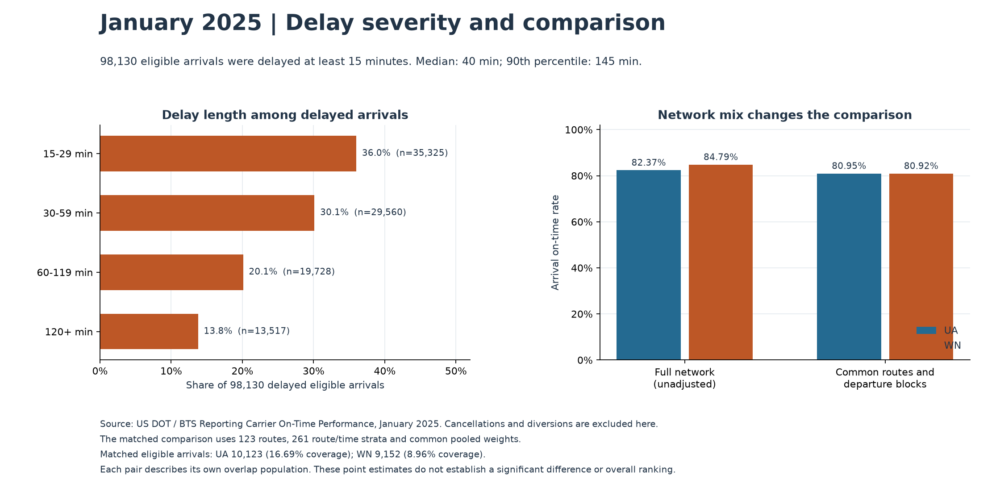

# Airline reliability in January 2025

An airline operations team needs to know where to investigate disruption, how many flights are affected, and whether comparisons reflect different operating networks. This analysis covers 539,747 US domestic flight records reported to the Bureau of Transportation Statistics for January 2025. Arrival reliability was 81.21%; cancellations affected 3.02% of scheduled flights. The results support reviewing the January 10 cancellation spike, high delay volumes on flights departing Denver, and reported air-carrier and late-aircraft delay categories.

## Business question and scope

Where were disruptions concentrated, and which dates, origins, routes, and departure windows warrant operational review? The intended decisions are investigation priorities and disruption planning. These are descriptive observations from one reporting month. Annual rankings and the prediction extension belong to a later release.

The [official BTS monthly archive](https://transtats.bts.gov/PREZIP/On_Time_Reporting_Carrier_On_Time_Performance_1987_present_2025_1.zip) contains 14 reporting carriers, 329 airports, and 5,649 directional routes. A reporting carrier may operate flights sold under another brand; the carrier field is not a marketing-airline label. This is the selected BTS reporting population, not all flights worldwide.

## Data preparation and metric definitions

Python downloads and inventories the complete archive. SQL in DuckDB produces typed source and analytical tables, observed airport/carrier dimensions, and dashboard exports. All 539,747 records remain in the data. Source and output checksums, duplicate checks, 21 core quality checks, and comparisons of every exported row make the process auditable.

One source record reports a negative diverted elapsed time. It is retained and flagged; that unused measurement does not enter the core reliability metrics. Signed early-arrival delays remain negative. Cancellations and diversions retain missing arrival-delay labels rather than becoming on-time flights.

| Measure | January result | Population |
| --- | --- | --- |
| Scheduled flights | 539,747 | All selected records |
| Eligible arrivals | 522,269 | Completed without diversion, with observed arrival delay |
| Arrival on-time rate | 81.21% | 424,139 arrivals below 15 minutes / 522,269 eligible arrivals |
| Delayed arrivals | 98,130 | Eligible arrivals delayed at least 15 minutes |
| Cancellation rate | 3.02% | 16,312 / 539,747 scheduled flights |
| Diversion rate | 0.22% | 1,166 / 539,747 scheduled flights |
| Median delay among delayed arrivals | 40 minutes | 98,130 delayed eligible arrivals |
| 90th-percentile delay among delayed arrivals | 145 minutes | Same delayed-arrival population |

Rates are ratios of summed counts. Ranked arrival-rate comparisons require at least 1,000 eligible arrivals per origin or 500 per route; departure-window cells require 100. Volume remains visible alongside each rate.

## Findings and investigation priorities

**January 10 had the highest cancellation rate.** There were 2,856 cancellations among 17,873 scheduled flights, or 15.98%, compared with 3.02% across the month. Review that day's station and dispatch records, identifying which carriers and routes contributed most before assigning an explanation. Monitor cancellation counts and scheduled-flight denominators together when assessing the affected scope.

**A low rate and a large affected population answer different questions.** Among origins with at least 1,000 eligible arrivals, GRR had the lowest arrival on-time rate: 73.93%, with 342 delayed arrivals out of 1,312 eligible arrivals. Flights departing DEN had a 75.06% on-time rate and 6,074 delayed arrivals out of 24,350 eligible arrivals. DEN is therefore a substantial volume for review even though GRR's rate is lower. These are arrival outcomes grouped by departure airport; they do not isolate an airport's responsibility.

**ORD–LGA had the largest delayed-arrival count among directional routes.** It recorded 200 delayed arrivals among 905 eligible arrivals, from 923 scheduled flights. Pair route rates with counts and review the carrier and departure-time mix rather than treating a small high-rate route as automatically the largest operational priority.

**Recorded air-carrier and late-aircraft categories account for 70.88% of category minutes.** Their individual shares were 36.16% and 34.72% of 6,943,994 reported minutes. All 98,130 delayed eligible arrivals had all five category fields populated, so no delayed eligible flight is omitted from this month's category chart. Use these categories to direct investigation into operational records. Reported attribution is not a causal decomposition or an estimate of preventable minutes; weather may also affect minutes reported in other categories.

**The long-delay group deserves explicit planning.** There were 13,517 arrivals delayed at least two hours: 13.77% of delayed arrivals and 2.59% of eligible arrivals. Reviewing reaccommodation and recovery procedures for these flights is a practical next step. Passenger counts, connections, and recovery actions would be needed to quantify passenger impact or financial outcomes.

## Why airline comparisons need a population definition

WN's full-network on-time rate was 84.79%, compared with 82.37% for UA, a difference of 2.42 percentage points. To examine network mix, the analysis compares carriers within shared directional routes and four-hour scheduled departure blocks. Both carriers receive the same pooled stratum weights.

The UA/WN comparison spans 123 shared routes and 261 strata. The resulting point estimates are 80.95% for UA and 80.92% for WN. This illustrates how changing the comparison population changes the observed gap. It does not establish a significant difference or an overall airline ranking: matched observations cover only 10,123 eligible UA arrivals (16.69% of its total) and 9,152 WN arrivals (8.96%). Each carrier pair has its own overlap population, and the adjustment does not control every operational difference.

## Tableau dashboards and deliverables

The analytics handoff includes a reproducible acquisition/preparation pipeline, ten reconciled SQL result exports, explicit denominator definitions, static figures, source/quality metadata, and a [Tableau build guide](../../docs/tableau_guide.md). The project owner has authored three dashboards in the [downloadable January workbook](https://github.com/Nihira11/airline-operations-analytics/raw/refs/heads/main/tableau/Airline%20Operations%20January%202025.twbx), which includes its data extract and images. View the screenshots of [Operations Overview](dashboard_screenshots/01-operations-overview.png), [Disruption Hotspots](dashboard_screenshots/02-disruption-hotspots.png), and [Delay Diagnostics](dashboard_screenshots/03-delay-diagnostics.png). The static figures earlier in this case study are separate SQL-analysis outputs. Final interaction and package reopen checks remain in the [Tableau progress notes](../../docs/tableau_progress.md).

The main limits are the single-month reporting scope, observational comparisons, and lack of passenger, financial, independent weather, or operational-log data. No measured business improvement or predictive performance is claimed.

## Evidence and reproduction

Use the [reproduction instructions](../../docs/reproduce.md), [data model](../../docs/data_model.md), [analysis manifest](../../data/metadata/bts_2025_01_analysis.json), and [quality report](../../data/metadata/bts_2025_01_quality.json). The [SQL queries](../../sql/analysis/) contain the metric definitions, ranking thresholds, category coverage, severity bands, and common-route weighting logic.

## Portfolio description

Built a reproducible Python and DuckDB analysis of 539,747 BTS flight records, preserving cancellations and diversions while validating types, duplicate keys, joins, and export consistency. Used SQL to quantify disruption hotspots, delay severity, reported category minutes, and airline comparison sensitivity to route/time mix. Built three Tableau dashboards with airline, date, and airport filters; supplied a packaged January workbook, dashboard screenshots, validated CSV inputs, figures, and a business case study.
